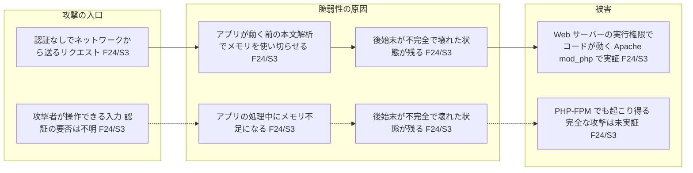
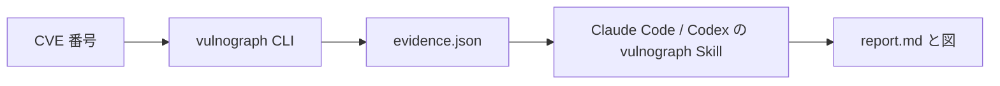

# vulnograph

Turn vulnerability data into visual understanding.

[English](README.md) | 日本語

[](https://github.com/hidetzu/vulnograph/actions/workflows/ci.yml)

CVE 番号を渡すと、その脆弱性を説明するレポートと図を作成します。攻撃の入口、何が壊れるのか、何が起こり得るのか、影響を受けるバージョン、対策がわかります。すべての主張に公式の出典を付け、出典に書かれていないことは推測で埋めずに「不明」と示します。

脆弱性情報を短時間で理解し、何を確認すべきかを判断したい開発者、インフラエンジニア、技術責任者向けです。

> [!NOTE]
> - vulnograph はスキャナではありません。利用者の環境が脆弱かどうかは判定しません。
> - 開発初期のリリース（0.1.0-dev.1）です。互換性のない変更が入る可能性があります。

## 得られるもの

CVE ごとに次のファイルを作成します。

```text
reports/CVE-2026-109618/
  report.md      # 要約、原因、成立条件、被害、影響・修正バージョン、対策、確認事項
  overview.mmd   # 初心者向けの概要図: 攻撃の入口 → 脆弱性の原因 → 被害
  diagram.mmd    # 技術詳細図: 出典が述べる因果関係
  evidence.json  # すべての主張の根拠となる収集データ
```

例として [CVE-2026-109618 のサンプルレポート](examples/CVE-2026-109618/report.md)（PHP のリモートコード実行の脆弱性）を参照してください。その概要図です。



図の読み方:

- `F24/S3` は、そのノードが evidence.json の出典 S3 から得た事実 F24 に基づくことを示します。各出典の URL と取得日時はレポートに載っています。
- 実線は出典が述べている関係、破線は出典が実証していない可能性です。
- 上下の 2 列は別々の攻撃経路です。出典に根拠のないノードは「不明」と描きます。

## 仕組み



1. **CLI**（Go 製）が公式情報を集め、各値がどこから来たかを記録します。LLM を使わず、解釈もしません。
2. **Skill**（Claude Code／Codex 用の [Agent Skill](https://code.claude.com/docs/en/skills)）がその根拠を読み、説明を書きます。確認済み・推定・不明・矛盾を区別し、すべての主張に事実を引用します。

情報源:

| 情報源 | 得られる情報 |
| --- | --- |
| [CVE Program](https://www.cve.org/) | CVE の公式レコード: 公開状態、説明、影響製品、CVSS、CWE、参照先 |
| [NVD](https://nvd.nist.gov/) | NIST の分析: CVSS、CWE、影響を受ける構成（CPE） |
| [GitHub Security Advisories](https://github.com/advisories)（GHSA） | CVE が参照するアドバイザリ（多くはプロジェクト自身が発行）: 詳細、影響・修正バージョン |
| [CISA KEV](https://www.cisa.gov/known-exploited-vulnerabilities-catalog) | 実際の悪用が確認されているか |
| [FIRST EPSS](https://www.first.org/epss/) | 悪用される確率の推定値 |

## はじめに

必要なもの:

- Go 1.24 以上
- レポートの作成に [Claude Code](https://code.claude.com/docs/en/skills) または [Codex](https://learn.chatgpt.com/docs/build-skills)

**1. CLI をビルドする。** まだリリースタグがないため、クローンしてビルドします。

```bash
git clone https://github.com/hidetzu/vulnograph.git
cd vulnograph
go install ./cmd/vulnograph   # $(go env GOPATH)/bin にインストール
vulnograph --version
```

Skill は `PATH` 上の `vulnograph` を実行するため、Claude Code や Codex を動かす環境で見つかる必要があります。`vulnograph --version` が見つからない場合は、`$(go env GOPATH)/bin` を `PATH` に追加してください。

**2. Skill をインストールする。** レポートを依頼するプロジェクトにリンクを作ります。既存の配置は上書きしません。

```bash
sh scripts/install-skill.sh claude /path/to/project   # .claude/skills/vulnograph
sh scripts/install-skill.sh codex /path/to/project    # .agents/skills/vulnograph
```

リンク先はクローン内の Skill です。クローンは移動せずに残してください。移動・削除した場合は、リンクを削除してからインストーラを再実行します。別のマシンではこのリンクは使えません。

**3. エージェントに依頼する。** そのプロジェクトで、Claude Code なら `/vulnograph`、Codex なら `$vulnograph` を使うか、普通の文で依頼します。

```text
CVE-2026-109618 を vulnograph で図解して
```

レポートは `reports/<CVE-ID>/` に作成されます。

## CLI だけを使う

```bash
vulnograph fetch CVE-2026-109618                    # evidence JSON を標準出力へ
vulnograph fetch CVE-2026-109618 --output reports/CVE-2026-109618/evidence.json
vulnograph fetch CVE-2026-109618 --fixture testdata/CVE-2026-109618   # クローン内の保存済みデータ、通信なし
```

フラグは CVE 番号の後に指定します。`--output` で新しく作るファイルの権限は 0644 で、既存のファイルは権限を保ちます。

API の認証情報は任意で、環境変数 `NVD_API_KEY` と `GITHUB_TOKEN` から読みます。設定するとレート制限が緩和されます。コマンド引数には渡さないでください。

| 終了コード | 意味 |
| --- | --- |
| `0` | 利用できる根拠を収集できた。一部の情報源は失敗している場合がある |
| `1` | 利用できる CVE／NVD レコードがない（例: CVE が予約済みのみで NVD にもない）、CVE が取り下げ済み、または出力に失敗した |
| `2` | 引数の誤り |

終了コードが 0 でも、JSON の `warnings` と各情報源の `status` を確認してください。一部の情報源が欠けたまま成功する場合があります。全項目は [evidence の形式](docs/evidence-format.md)（英語）を参照してください。

## 制限事項

- レポートの品質は、まだ 1 件の CVE でしか確認していません。10〜20 件の CVE での確認を予定しています（[残作業](docs/design.md#remaining-work)）。
- Skill は事実や攻撃経路を創作しないよう指示されていますが、文章は AI が書きます。重要な主張は引用された出典で確認してください。
- ベンダーの Web ページは取得しません。取得するのは CVE が参照する GitHub のアドバイザリだけです。その他の参照先は一覧として残します。
- CISA KEV に載っていないことは「悪用されていない」ことを意味しません。EPSS は特定の日の推定値です。ディストリビューションのバックポート修正は自分で確認してください。
- 情報源間の違いは報告するだけで、どちらかに統一しません。

## ドキュメント

- [evidence の形式](docs/evidence-format.md)（英語）: JSON の全項目と status
- [通信と安全性](docs/network-and-safety.md)（英語）: 接続先、制限、認証情報、非信頼データの扱い
- [Skill の手順](skills/vulnograph/SKILL.md): レポートと図の書き方
- [設計](docs/design.md)（英語）: 目的、原則、リリース計画、残作業
- [設計判断](docs/decisions.md)（英語）: 判断とその理由
- [テストデータ](testdata/README.md)（英語）: fixture の出典
- [CHANGELOG](CHANGELOG.md)

## 貢献

[CONTRIBUTING.md](CONTRIBUTING.md)（英語）を参照してください。テストは通信なしで実行できます。

```bash
go test -race ./...
```

vulnograph 自体の脆弱性の報告は [SECURITY.md](SECURITY.md)（英語）を参照してください。

## ライセンス

ソースコードは [MIT License](LICENSE)。testdata と examples の保存済み API データの内容の権利は、各情報提供元に帰属します。
