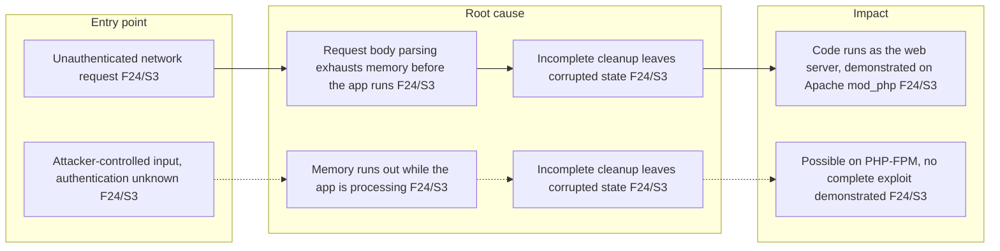
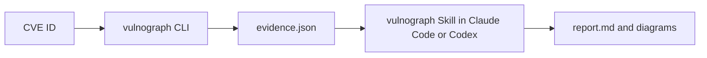

# vulnograph

Turn vulnerability data into visual understanding.

English | [日本語](README.ja.md)

[](https://github.com/hidetzu/vulnograph/actions/workflows/ci.yml)

Give vulnograph a CVE ID, and it produces a report and diagrams that explain the vulnerability: how an attacker gets in, what goes wrong, what can happen, which versions are affected, and how to fix it. Every claim cites the official source it came from, and what the sources do not say is marked as unknown rather than guessed.

It is meant for developers, infrastructure engineers and technical leads who need to understand a CVE quickly and decide what to check.

> [!NOTE]
> - Reports are currently written in **Japanese** only.
> - vulnograph is not a scanner. It does not decide whether your environment is vulnerable.
> - This is an early development release (0.1.0-dev.1). Expect breaking changes.

## What you get

For each CVE, vulnograph writes:

```text
reports/CVE-2026-109618/
  report.md      # Summary, root cause, conditions, impact, affected and fixed versions, mitigations, open questions
  overview.mmd   # Beginner-friendly diagram: entry point -> root cause -> impact
  diagram.mmd    # Technical diagram: the causal chain described by the sources
  evidence.json  # The collected source data that every claim cites
```

See the [sample report for CVE-2026-109618](examples/CVE-2026-109618/report.md), a PHP remote code execution vulnerability. Its overview diagram, translated into English for this README:



How to read it:

- `F24/S3` means the node is based on fact F24 from source S3 in `evidence.json`; the report lists each source's URL and retrieval time.
- Solid arrows are stated by the sources. Dashed arrows are possibilities the sources have not demonstrated.
- The two rows are separate attack paths. A node the sources do not support is drawn as unknown.

## How it works



1. The **CLI**, written in Go, collects official data and records where each value came from. It does not use an LLM and does not interpret anything.
2. The **Skill**, an [Agent Skill](https://code.claude.com/docs/en/skills) for Claude Code or Codex, reads that evidence and writes the explanation. It separates confirmed facts, estimates, unknowns and conflicts, and cites a fact for every claim.

Sources:

| Source | What it provides |
| --- | --- |
| [CVE Program](https://www.cve.org/) | The official CVE record: state, description, affected products, CVSS, CWE, references |
| [NVD](https://nvd.nist.gov/) | NIST's analysis: CVSS, CWE, affected configurations (CPE) |
| [GitHub Security Advisories](https://github.com/advisories) (GHSA) | Advisories referenced by the CVE, often from the project itself: details, affected and patched versions |
| [CISA KEV](https://www.cisa.gov/known-exploited-vulnerabilities-catalog) | Whether the CVE is known to be exploited in the wild |
| [FIRST EPSS](https://www.first.org/epss/) | Estimated probability of exploitation |

## Getting started

You need:

- Go 1.24 or later
- [Claude Code](https://code.claude.com/docs/en/skills) or [Codex](https://learn.chatgpt.com/docs/build-skills), to write reports

**1. Build the CLI.** No release has been tagged yet, so build from a clone.

```bash
git clone https://github.com/hidetzu/vulnograph.git
cd vulnograph
go build -o vulnograph ./cmd/vulnograph
```

Put the `vulnograph` binary on your `PATH`, or the agent can run `go run ./cmd/vulnograph` from this repository.

**2. Install the Skill** into the project where you will ask for reports. This creates a link and never overwrites an existing entry.

```bash
sh scripts/install-skill.sh claude /path/to/project   # .claude/skills/vulnograph
sh scripts/install-skill.sh codex /path/to/project    # .agents/skills/vulnograph
```

**3. Ask the agent.** In that project, run `/vulnograph` in Claude Code or `$vulnograph` in Codex, or ask in plain words:

```text
Explain CVE-2026-109618 with vulnograph
```

The report is written to `reports/<CVE-ID>/`.

## Using the CLI on its own

```bash
./vulnograph fetch CVE-2026-109618                    # print evidence JSON to stdout
./vulnograph fetch CVE-2026-109618 --output reports/CVE-2026-109618/evidence.json
./vulnograph fetch CVE-2026-109618 --fixture testdata/CVE-2026-109618   # saved data, no network
```

Flags go after the CVE ID. With `--output`, a new file is created with mode 0644, and an existing file keeps its permissions.

Optional API credentials are read from the `NVD_API_KEY` and `GITHUB_TOKEN` environment variables; they raise rate limits. Never pass them as arguments.

| Exit code | Meaning |
| --- | --- |
| `0` | Usable evidence was collected. Some sources may still have failed |
| `1` | No usable CVE or NVD record (for example, the CVE is only reserved and NVD has no record), the CVE is rejected, or the output could not be written |
| `2` | Invalid arguments |

Even with exit code 0, read `warnings` and each source's `status` in the JSON: a run can succeed with some sources missing. See [Evidence format](docs/evidence-format.md) for every field.

## Limitations

- Reports are in Japanese. Report quality has been checked on one CVE so far; review against 10–20 CVEs is planned.
- The Skill is guided to avoid invented facts and attack paths, but its output is written by an AI. Check important claims against the cited sources.
- Vendor web pages are not fetched; only GitHub advisories referenced by the CVE are. Other references are listed for you to read.
- Absence from CISA KEV does not mean "not exploited". EPSS is an estimate on a given date. Check backported fixes from your distribution yourself.
- Differences between sources are reported, not resolved.

## Documentation

- [Evidence format](docs/evidence-format.md): every JSON field and status
- [Network access and safety](docs/network-and-safety.md): hosts, limits, credentials and untrusted content
- [Skill instructions](skills/vulnograph/SKILL.md): how reports and diagrams are written (Japanese)
- [Design decisions](docs/decisions.md) and [initial design](docs/implementation-plan.md) (Japanese)
- [CHANGELOG](CHANGELOG.md)

## Contributing

See [CONTRIBUTING.md](CONTRIBUTING.md). Tests run offline:

```bash
go test -race ./...
```

To report a vulnerability in vulnograph itself, see [SECURITY.md](SECURITY.md).

## License

The source code is licensed under the [MIT License](LICENSE). Rights to the content of the saved API data in `testdata` and `examples` belong to their respective providers.
