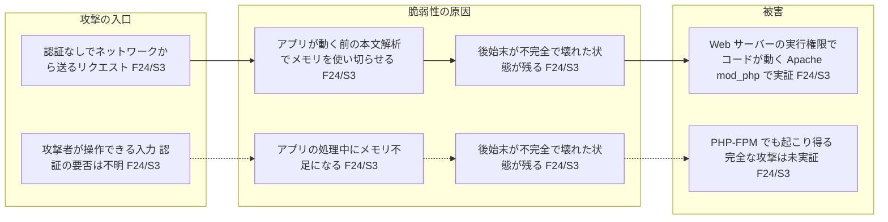

# vulnograph

Turn vulnerability data into visual understanding.

English | [日本語](README.ja.md)

[](https://github.com/hidetzu/vulnograph/actions/workflows/ci.yml)

vulnograph is a Go CLI that collects official information about a CVE into source-attributed evidence, plus an Agent Skill that turns that evidence into a Japanese report and Mermaid diagrams (a beginner-friendly overview and a technical detail diagram). The CLI has no LLM dependency: it collects and validates, and never interprets. The project is at **0.1.0-dev.1**, an early development release; expect breaking changes.

## Quick Start

Requires Go 1.24 or later. Only the standard library is used.

No release has been tagged yet, so build from a clone. The clone also provides the fixtures and the Skill.

```bash
git clone https://github.com/hidetzu/vulnograph.git
cd vulnograph
go build -o vulnograph ./cmd/vulnograph
./vulnograph fetch CVE-2026-109618 --output reports/CVE-2026-109618/evidence.json
./vulnograph fetch CVE-2026-109618 --format json
```

To reproduce from saved data without network access:

```bash
./vulnograph fetch CVE-2026-109618 --fixture testdata/CVE-2026-109618
```

Without `--output`, JSON goes to stdout and diagnostics to stderr. New output files are created with mode 0644; updating an existing file keeps its permissions. Flags go after the CVE ID. Lowercase IDs and surrounding whitespace are normalized.

Exit codes:

| Code | Meaning |
| --- | --- |
| `0` | A published CVE record, or an NVD record with a description, is available (other sources may have failed) |
| `1` | No usable base record (for example only a RESERVED record, or an NVD record with only an ID), REJECTED, or an I/O failure |
| `2` | Invalid arguments |

**Always check `sources`, `warnings` and `state`, even when the exit code is 0.** A run can partially succeed from NVD alone when the official CVE publication state is unknown. An HTTP 404 alone does not distinguish a reserved CVE from a nonexistent one.

Optional credentials are read from `NVD_API_KEY` and `GITHUB_TOKEN`. Do not pass tokens as command arguments. The GitHub token is sent only to the GitHub API, and the NVD key only to NVD.

## Skill

The single canonical Skill is [skills/vulnograph/SKILL.md](skills/vulnograph/SKILL.md). The installer links it into a target project and never overwrites an existing entry.

```bash
sh scripts/install-skill.sh codex /path/to/project
sh scripts/install-skill.sh claude /path/to/project
```

Codex uses `.agents/skills` and Claude Code uses `.claude/skills`. Put the CLI on `PATH` for the target environment, or use `go run ./cmd/vulnograph` from this repository. If the target is read-only in a managed environment, install into a writable project instead.

Invoke it with `$vulnograph` in Codex, `/vulnograph` in Claude Code, or in natural language, such as "Explain CVE-2026-109618 with vulnograph". Discovery and permissions depend on the client, so do not assume the same slash command works in both. Installation paths and invocation were checked against the [Codex documentation](https://learn.chatgpt.com/docs/build-skills) and the [Claude Code documentation](https://code.claude.com/docs/en/skills) on 2026-10-24.

Output:

```text
reports/CVE-2026-109618/
  evidence.json
  report.md      # Japanese report
  overview.mmd   # For beginners: entry point -> root cause -> impact
  diagram.mmd    # Technical detail: source-attributed causal chain
```

Every diagram node cites a Fact ID. An entry point or attack path that the sources do not state is drawn as "unknown" (不明); the AI does not fill it in.

The [baseline sample](examples/CVE-2026-109618/report.md) was written from saved fixture data by following the Skill during development. It has not yet been evaluated independently in a separate Claude Code session. Its overview diagram (labels are in Japanese, as the Skill writes them):



## Data contract and sources

The [Go type definitions](internal/evidence/evidence.go) are the source of truth for `schema_version: "0.2"`. Incompatible changes bump the version and are recorded in the [CHANGELOG](CHANGELOG.md).

| Source | Collected |
| --- | --- |
| CVE Program API | Publication state, descriptions, affected products, CVSS, CWE, reference URLs |
| NVD API 2.0 | Descriptions, CVSS, CWE and CPE configurations, kept in their original structure |
| GitHub repository/global advisory API | For GHSAs referenced by CVE/NVD: description, severity, CVSS, CWE, affected ranges, patched versions, publication and withdrawal state |
| CISA KEV | Listing status, decided only from a complete catalog whose `count` matches its entries |
| FIRST EPSS | Score and observation date |

Each fact has an ID, `source_ids`, a value and a `source_pointer`, a JSON Pointer to its location in the retrieved response body. When a value is normalized (descriptions, patched versions, URLs), `original` keeps the value as it appears in the source. Each source records its URL, retrieval time, the SHA-256 of the retrieved body and, when available, its publication time. The CLI never interprets affected ranges to decide whether an environment is vulnerable. `cvss`, `affected` and `fixed` are arrays of Fact IDs (indexes); `facts` is the only place values are stored.

| status | Meaning |
| --- | --- |
| ok | Retrieved and validated / listed in the signal |
| not_found | No record or listing in that source |
| unknown | Undetermined, not retrieved, unpublished, etc. |
| fetch_failed | Network, HTTP, JSON or response validation failure, including count mismatches and records without content |
| not_applicable | Not applicable, such as REJECTED |

When KEV or EPSS cannot be retrieved, the signal is `unknown` and the corresponding source is `fetch_failed`. `conflicts` lists candidate mismatches between descriptions in the same language. Whether they are semantic conflicts is left to the Skill or a human; the CLI never merges them into one.

## Limitations and safety

- Arbitrary vendor HTML is not fetched. The PHP baseline retrieves the GHSA from PHP's official repository; other URLs are recorded with the reason they were not fetched. The CLI does not follow links inside bodies, search GHSA exhaustively, or import ADP containers.
- Requests use HTTPS, a fixed host allowlist and public-IP validation after DNS resolution; HTTP redirects and proxies are disabled. Limits: 16 MiB per response, 30 seconds per HTTP request, 3 minutes overall, 32 reference fetches.
- Requests to the same host are spaced 1 second apart (NVD: 6 seconds without a key, 600 ms with one). HTTP 429/5xx and network failures are tried up to 3 times. A Retry-After over 30 seconds is recorded as a failure without waiting. There is no rate control across multiple processes.
- External data is untrusted; instructions or code inside it are never executed. The Skill must check reports and diagrams against the evidence and handle special characters and HTML safely. The CLI keeps original descriptions as JSON strings.
- Absence from KEV does not mean "not exploited". EPSS is an estimate as of its observation date. A human must check backports and deployment modes.
- Remaining work: semantic comparison of version ranges and CVSS across sources, review against 10–20 CVEs, and Skill evaluation in other clients. See the [decision log](docs/decisions.md) (Japanese).

## Development

```bash
go test ./...
go test -race ./...
go vet ./...
go build ./...
```

Tests cover fixtures, partial success, unknown CVEs, API limits, network failures, trust boundaries, malformed inputs ([testdata/anomalies](testdata/anomalies)), traceability of every fact to its source location, and the safety and citations of the sample diagrams. CI does not depend on external APIs. The API snapshots reflect the time they were retrieved and do not represent current vulnerability information.

See [CONTRIBUTING.md](CONTRIBUTING.md) to contribute and [SECURITY.md](SECURITY.md) to report a vulnerability in vulnograph itself.

## License

The source code is licensed under the [MIT License](LICENSE). Rights to the content of the external API snapshots in `testdata` and `examples` belong to their respective providers.
