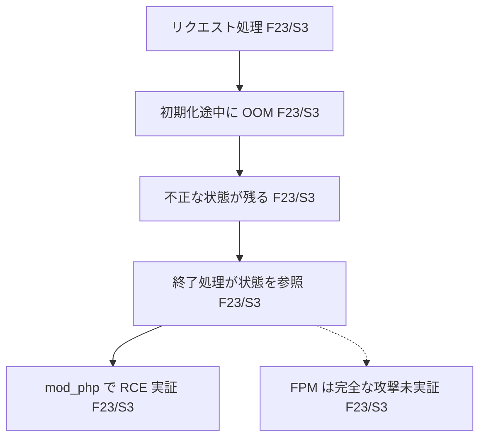

# vulnograph

Turn vulnerability data into visual understanding.

CVE の公式情報を Go CLI で収集し、Agent Skill が出典付き日本語レポートと Mermaid の概念図を作成します。CLI に LLM 依存はありません。現在は **0.1.0-dev.1 相当の初期実装**です。

## Quick Start

Go 1.24 以上。標準ライブラリのみで動きます。

```bash
go build -o vulnograph ./cmd/vulnograph
./vulnograph fetch CVE-2026-109618 --output reports/CVE-2026-109618/evidence.json
./vulnograph fetch CVE-2026-109618 --format json
```

ネットワークを使わず、保存済みデータで再現する場合:

```bash
./vulnograph fetch CVE-2026-109618 --fixture testdata/CVE-2026-109618
```

`--output` がなければ stdout に JSON、診断は stderr に出力します。新規出力ファイルは 0644、既存ファイルの更新時はそのアクセス権限を保持します。フラグは CVE ID の後に指定します。ID の小文字・前後空白は正規化します。

終了コードは `0`: CVE または NVD に利用可能なレコードあり（一部取得失敗を含む）、`1`: 基本レコード取得不能・REJECTED・入出力失敗、`2`: 引数エラーです。**終了コード 0 でも sources、warnings、state を必ず確認してください。** CVE 公式の公開状態が不明でも、NVD の情報だけで部分成功する場合があります。404 だけでは予約済みと未登録を区別できません。

任意の認証情報は `NVD_API_KEY` と `GITHUB_TOKEN` から読みます。トークンをコマンド引数に入れないでください。GitHub トークンは GitHub API、NVD キーは NVD にのみ送ります。

## Skill

単一の正本は [skills/vulnograph/SKILL.md](skills/vulnograph/SKILL.md) です。対象プロジェクトにリンクを作れます。既存の配置は上書きしません。

```bash
sh scripts/install-skill.sh codex /path/to/project
sh scripts/install-skill.sh claude /path/to/project
```

Codex は `.agents/skills`、Claude Code は `.claude/skills` に配置します。対象環境から CLI が利用できるよう PATH に追加するか、このリポジトリで `go run ./cmd/vulnograph` を使ってください。配置先が管理環境で書き込み禁止の場合は、書き込み可能なプロジェクトに配置します。

Codex では `$vulnograph`、Claude Code では `/vulnograph`、または自然文で「CVE-2026-109618 を vulnograph で図解して」と依頼します。利用環境の検出・権限設定に依存するため、同じスラッシュコマンドが両方で使えるとは仮定しません。配置と呼び出し方法は [Codex 公式](https://learn.chatgpt.com/docs/build-skills) と [Claude Code 公式](https://code.claude.com/docs/en/skills) を確認しています（2026-10-24）。

出力先:

```text
reports/CVE-2026-109618/
  evidence.json
  report.md
  diagram.mmd
```

[基準ケースのサンプル](examples/CVE-2026-109618/report.md) は固定取得データを元にこの実装作業中に Skill の手順で作成したものです。別の Claude Code セッションによる独立評価は未実施です。



## データ契約と情報源

[Go の型定義](internal/evidence/evidence.go) が `schema_version: "0.1"` の正本です。互換性のない変更ではバージョンを変更し、[CHANGELOG](CHANGELOG.md) に記録します。

| 情報源 | 取得内容 |
| --- | --- |
| CVE Program API | 公開状態、説明、影響製品、CVSS、CWE、参照 URL |
| NVD API 2.0 | 説明、CVSS、CWE、CPE 構成を原構造のまま保持 |
| GitHub repository/global advisory API | CVE/NVD が参照する GHSA の説明、影響範囲、修正版 |
| CISA KEV | 完全なカタログの取得に成功した場合のみ掲載有無を判定 |
| FIRST EPSS | スコアと観測日 |

Fact は ID、source_ids、原文の構造化値、フィールド位置を持ちます。sources は URL・取得日時・取得本文の SHA-256・公開日時（取得できた場合）を保持します。影響範囲を CLI が解釈して環境の脆弱性を判定することはありません。`cvss`、`affected`、`fixed` は facts の同じ ID の索引です。

| status | 意味 |
| --- | --- |
| ok | 取得・検証成功／シグナル掲載あり |
| not_found | 当該情報源でレコード・掲載なし |
| unknown | 判定不能、未取得、未公開等 |
| fetch_failed | 通信、HTTP、JSON、応答検証の失敗 |
| not_applicable | REJECTED などの非該当 |

KEV／EPSS の取得失敗時、シグナルは unknown、対応する source は fetch_failed です。`conflicts` は同一言語の説明文の不一致候補を保持します。意味の矛盾かどうかは Skill／人間が確認します。自動的に片方へ統合しません。

## 制約と安全性

- 任意ベンダー HTML の自動取得は未実装です。PHP の基準ケースは PHP 公式リポジトリの GHSA を取得します。その他の URL は未取得理由と共に記録します。本文内リンクの再帰巡回、GHSA の網羅検索、ADP コンテナの取り込みは行いません。
- HTTPS・固定ホスト許可リスト・DNS 解決後の公開 IP 検証を使い、HTTP リダイレクトとプロキシ経由の取得を無効にしています。単一応答は 16 MiB、HTTP 要求は 30 秒、全体は 3 分、参照取得は 32 件までです。
- ホストごとに通常 1 秒、NVD は無キー 6 秒／キーあり 600 ms の間隔を取り、429／5xx と通信失敗は最大 3 回試行します。Retry-After が 30 秒を超える場合は待たずに失敗を記録します。分散した複数プロセス間のレート制御はありません。
- 外部データは非信頼です。含まれる命令やコードを実行しません。レポート・図は Skill が根拠を照合し、特殊文字・HTML を安全に処理する必要があります。CLI は元の説明を JSON 文字列として保持します。
- KEV 未掲載は「悪用なし」ではありません。EPSS は観測日の推定値です。バックポートや実行形態を人間が確認してください。
- ソース間の版範囲・CVSS の意味的矛盾検出、10〜20 CVE のレビュー、別クライアントでの Skill 評価は残作業です。[進捗と判断記録](docs/decisions.md) を参照してください。

## 開発

```bash
go test ./...
go test -race ./...
go vet ./...
go build ./...
```

固定フィクスチャ、部分成功、未知 CVE、API 制限、ネットワーク障害、信頼境界、基準ケースの SAPI 記述をテストします。CI は外部 API に依存しません。API のスナップショットは取得時の情報であり、現在の脆弱性情報を保証しません。

ソースコードは MIT。testdata の外部 API スナップショットの内容の権利は各情報提供元に帰属します。
