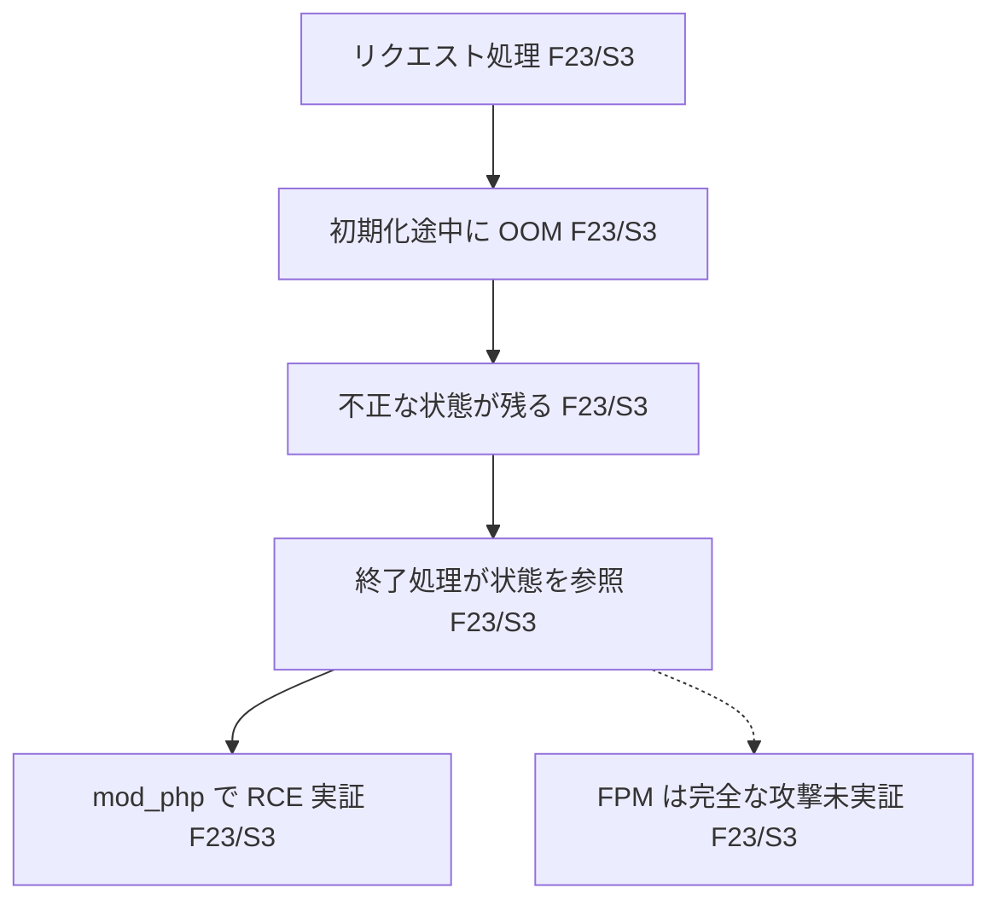

# CVE-2026-109618

保存済みの公式 API データに基づくサンプル。取得日時: 2026-10-24T04:48:16.323813Z。ライブ更新は反映していない。

## 30秒で理解する要約

**確認済み**: PHP のメモリ不足時の処理によって不正な状態が残り、リクエスト終了時の処理からコード実行につながる。Apache mod_php では認証なしの RCE が実証されている。FPM での完全な攻撃は未実証。[F23 / PHP 公式 GHSA](https://github.com/php/php-src/security/advisories/GHSA-w8hw-w9fx-j79w)

## 原因

**確認済み**: メモリ不足により処理を早期に抜けたとき、初期化途中のメモリが残る場合がある。本来は完全な状態を扱う終了処理が、不正な状態を参照してしまう。[F23 / S3](https://github.com/php/php-src/security/advisories/GHSA-w8hw-w9fx-j79w)

## 攻撃・障害の因果関係

出典の説明を簡略化した概念図。FPM の破線は解析上の可能性を示す。

## 成立条件

**確認済み**: mod_php の実証は通常の prefork 構成とデフォルトの入力・メモリ制限で行われた。**推定**: FPM は起動後の処理経路に影響の可能性がある。これはソース解析に基づき、完全な FPM exploit の実証を意味しない。**不明**: 利用者のアプリケーションでの成立。[F23 / S3](https://github.com/php/php-src/security/advisories/GHSA-w8hw-w9fx-j79w)

## 起こり得る被害

**確認済み**: 実証されたコード実行の権限は Web ワーカーの権限。**不明**: 個別環境におけるデータアクセス範囲や追加被害。[F23 / S3](https://github.com/php/php-src/security/advisories/GHSA-w8hw-w9fx-j79w)

## 影響・修正バージョン

**確認済み**: 以下は CNA が示すブランチごとの範囲と、GHSA に記載された修正版。[F3 / CVE 公式](https://cveawg.mitre.org/api/cve/CVE-2026-109618)、[F24–F31 / PHP 公式 GHSA](https://github.com/php/php-src/security/advisories/GHSA-w8hw-w9fx-j79w)

| ブランチ | CNA の影響範囲 | 修正版 |
| --- | --- | --- |
| 8.2 | 8.2.* かつ 8.2.35 未満 | 8.2.35 |
| 8.3 | 8.3.* かつ 8.3.36 未満 | 8.3.36 |
| 8.4 | 8.4.* かつ 8.4.27 未満 | 8.4.27 |
| 8.5 | 8.5.* かつ 8.5.12 未満 | 8.5.12 |

**不明**: これ以外のブランチや各ディストリビューションの状態はこの表から判断できない。バックポート修正の有無をベンダーに確認する。

## 対策

**確認済み**: 修正を含む PHP への更新が完全対策。設定変更やコンテナの制限は完全対策ではなく、残余リスクがある。[F23 / S3](https://github.com/php/php-src/security/advisories/GHSA-w8hw-w9fx-j79w)

運用上の確認として、配布元の修正状況を確認して更新し、実際に稼働するワーカーが更新済みであることを確認する。

## 確認事項

- 稼働ブランチ、実行形態、配布元の修正パッケージは何か。
- ワーカーの権限と、アクセス可能なデータは何か。
- 更新後に残存プロセスがないか。暫定策に依存していないか。

## 出典・未確認事項

主要な技術的主張は S3 の直接記述に基づく。これは利用者環境での検証済みという意味ではない。

| 出典 | URL | 取得日時 UTC |
| --- | --- | --- |
| S1 / CVE 公式 | [CVE record](https://cveawg.mitre.org/api/cve/CVE-2026-109618) | 2026-10-24T04:48:16.323813Z |
| S2 / NVD | [NVD API](https://services.nvd.nist.gov/rest/json/cves/2.0?cveId=CVE-2026-109618) | 同上 |
| S3 / PHP 公式 | [GHSA-w8hw-w9fx-j79w](https://api.github.com/repos/php/php-src/security-advisories/GHSA-w8hw-w9fx-j79w) | 同上 |
| S8 / KEV | [CISA catalog](https://www.cisa.gov/sites/default/files/feeds/known_exploited_vulnerabilities.json) | 同上 |
| S9 / EPSS | [FIRST API](https://api.first.org/data/v1/epss?cve=CVE-2026-109618) | 同上 |

**確認済み**: 保存した完全な KEV カタログに本 CVE は未掲載。悪用がないという意味ではない。[S8](https://www.cisa.gov/sites/default/files/feeds/known_exploited_vulnerabilities.json)

**確認済み**: EPSS は 2026-10-23 観測で 0.1162。これは悪用確率の推定値であり、CVSS や利用者環境の危険度とは異なる。[S9](https://api.first.org/data/v1/epss?cve=CVE-2026-109618)

説明文の差は evidence.json の conflicts に候補として保持した。意味的矛盾とは自動断定していない。S4–S7 の参照先は未取得で、このレポートの根拠にしていない。個別環境の影響、未対応の古いブランチ、バックポート状況は未確認。
