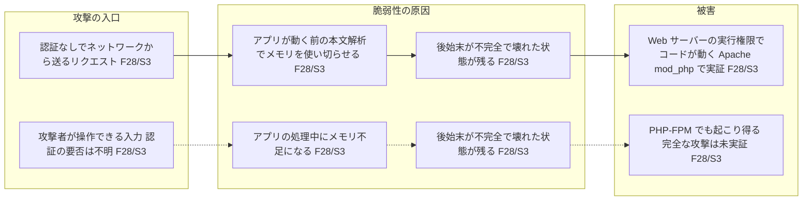
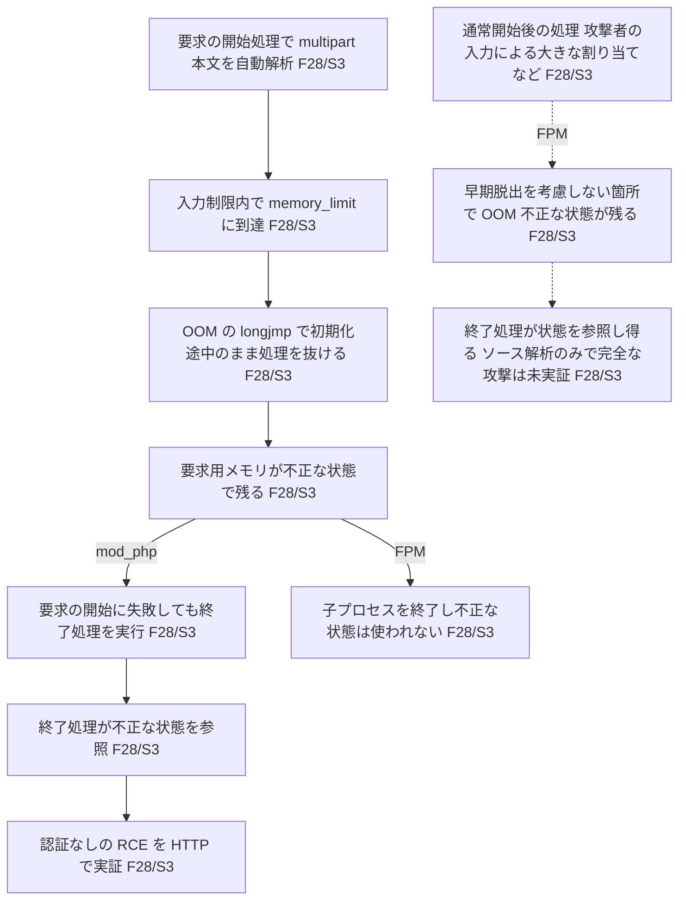

# CVE-2026-109618

保存済みの公式 API データ（evidence schema 0.3）に基づくサンプル。取得日時: 2026-10-24T04:48:16.323813Z。ライブ更新は反映していない。

## 30秒で理解する要約

**確認済み**: PHP のメモリ不足時の処理によって不正な状態が残り、リクエスト終了時の処理からコード実行につながる。Apache mod_php では認証なしの RCE が実証されている。FPM での完全な攻撃は未実証。[F28 / PHP 公式 GHSA](https://github.com/php/php-src/security/advisories/GHSA-w8hw-w9fx-j79w)

**確認済み**: 深刻度は CNA が CVSS 4.0 で 9.2、NVD が CVSS 3.1 で 9.8、GHSA が critical。版と評価者が異なるため、数値をそのまま比べない。[F8 / CVE 公式](https://cveawg.mitre.org/api/cve/CVE-2026-109618)、[F18 / NVD](https://services.nvd.nist.gov/rest/json/cves/2.0?cveId=CVE-2026-109618)、[F29・F30 / PHP 公式 GHSA](https://github.com/php/php-src/security/advisories/GHSA-w8hw-w9fx-j79w)

## 全体像

専門用語を省いた概要図。どこから入り、何が壊れ、何が起きるかだけを示す。上の経路と下の経路は別の攻撃であり、途中でつながらない。破線は可能性（未実証）。

上の経路では、ファイルアップロードなどに使う multipart 形式の本文を、アプリケーションのコードが動く前に PHP 自身が解析する段階でメモリ不足を起こす。Apache mod_php ではここからコード実行が実証されている。PHP-FPM はこの段階で失敗すると処理中の子プロセスを終了するため、壊れた状態は使われない。[F28 / S3](https://github.com/php/php-src/security/advisories/GHSA-w8hw-w9fx-j79w)

下の経路は、通常どおり処理が始まった後に、アプリケーション固有の処理でメモリ不足になる場合。出典はソース解析に基づき PHP-FPM も影響を受け得るとしているが、完全な攻撃は実証されていない。この経路で認証が必要かどうかは出典に記載がない。[F28 / S3](https://github.com/php/php-src/security/advisories/GHSA-w8hw-w9fx-j79w)

## 原因

**確認済み**: メモリ不足（OOM）のとき PHP は `longjmp()` で処理を早期に抜ける。初期化途中の要求用メモリが参照可能な状態でこれが起きると、不正な状態が残る。本来は完全な状態を扱う終了処理が、その不正な状態を参照してしまう。失敗した割り当て自体は不正なメモリと無関係でもよい。[F28 / S3](https://github.com/php/php-src/security/advisories/GHSA-w8hw-w9fx-j79w)

**確認済み**: CWE は CWE-416（解放後使用）、CWE-755、CWE-824、CWE-1325、CWE-1419。[F9–F13 / CVE 公式](https://cveawg.mitre.org/api/cve/CVE-2026-109618)、[F31–F35 / S3](https://github.com/php/php-src/security/advisories/GHSA-w8hw-w9fx-j79w)

## 攻撃・障害の因果関係

出典の説明を簡略化した技術詳細図。要求の開始処理中の OOM（上）と、通常開始後の OOM（下）は別経路として描く。開始処理中の OOM は実行形態で分岐し、FPM では子プロセスの終了で止まる。破線はソース解析に基づく可能性で、完全な攻撃は未実証。

## 成立条件

**確認済み**: mod_php の実証は、デフォルトの PHP 入力・メモリ制限と通常の prefork 構成（複数ワーカー）で HTTP 経由で行われた。アプリケーション固有のコードが動く前に起きる。[F28 / S3](https://github.com/php/php-src/security/advisories/GHSA-w8hw-w9fx-j79w)

**確認済み**: FPM は要求の開始に失敗すると子プロセスを終了するため、mod_php で実証された経路では不正な状態が使われない。[F28 / S3](https://github.com/php/php-src/security/advisories/GHSA-w8hw-w9fx-j79w)

**推定**: FPM は、通常開始後に別の経路で OOM に達した場合に影響を受ける可能性がある。これはソース解析に基づき、完全な FPM exploit の実証を意味しない。FrankenPHP は mod_php と同様、LSAPI は FPM と同様と出典は推定している。[F28 / S3](https://github.com/php/php-src/security/advisories/GHSA-w8hw-w9fx-j79w)

**不明**: 利用者のアプリケーション・ビルド・拡張・フロントエンドでの成立。出典は信頼性がこれらに依存するとしている。[F28 / S3](https://github.com/php/php-src/security/advisories/GHSA-w8hw-w9fx-j79w)

## 起こり得る被害

**確認済み**: 実証されたコード実行の権限は Web ワーカーのアカウント。[F28 / S3](https://github.com/php/php-src/security/advisories/GHSA-w8hw-w9fx-j79w)

**不明**: 個別環境におけるデータアクセス範囲や追加被害。

## 影響・修正バージョン

**確認済み**: 以下は CNA が示すブランチごとの範囲と修正版、および GHSA に記載された修正版。CNA の修正版は、範囲外を非該当（defaultStatus: unaffected）と宣言した影響範囲の上限から CLI が導出したもので、GHSA の値と一致する。[F3–F7 / CVE 公式](https://cveawg.mitre.org/api/cve/CVE-2026-109618)、[F36–F43 / PHP 公式 GHSA](https://github.com/php/php-src/security/advisories/GHSA-w8hw-w9fx-j79w)

| ブランチ | CNA の影響範囲 | 修正版（CNA） | 修正版（GHSA） |
| --- | --- | --- | --- |
| 8.2 | 8.2.* かつ 8.2.35 未満 | 8.2.35 (F4) | 8.2.35 (F37) |
| 8.3 | 8.3.* かつ 8.3.36 未満 | 8.3.36 (F5) | 8.3.36 (F39) |
| 8.4 | 8.4.* かつ 8.4.27 未満 | 8.4.27 (F6) | 8.4.27 (F41) |
| 8.5 | 8.5.* かつ 8.5.12 未満 | 8.5.12 (F7) | 8.5.12 (F43) |

**不明**: これ以外のブランチや各ディストリビューションの状態はこの表から判断できない。バックポート修正の有無をベンダーに確認する。

## 対策

**確認済み**: 修正を含む PHP への更新が唯一の完全な対策。`memory_limit=-1` は主な設定上の緩和策だが完全ではなく、`mmap()` などの割り当て失敗では脆弱な経路が残る。コンテナ・cgroup のメモリ制限も完全な対策ではない。`RLIMIT_AS`／`RLIMIT_DATA` は脆弱な経路を引き起こすため使わない。[F28 / S3](https://github.com/php/php-src/security/advisories/GHSA-w8hw-w9fx-j79w)

**確認済み**: すぐに更新できない場合、出典は次の暫定策を挙げている。[F28 / S3](https://github.com/php/php-src/security/advisories/GHSA-w8hw-w9fx-j79w)

- `memory_limit=-1` を管理者設定として強制し、すべての PHP ワーカーを再起動する。プール、ディレクトリ、アプリケーションの設定で有限の値に戻っていないことを確認する。
- `post_max_size` を控えめにし、デコード後の本文サイズをフロントエンドでも独立して制限する。
- `max_input_nesting_level` を下げ、入力変数、multipart の部分数、部分ごとのヘッダ数、アップロード数を制限する。
- アプリケーションが multipart 形式を使わない場合は、PHP に届く前にフロントエンドで遮断する。

これらは修正後もハード OOM やサービス停止のリスクを下げるが、更新の代わりにはならない。コンテナ・cgroup の制限では、各ワーカーが個別のグループでない場合、強制終了でマスタープロセスとすべてのワーカーが止まることがある。[F28 / S3](https://github.com/php/php-src/security/advisories/GHSA-w8hw-w9fx-j79w)

運用上の確認として、配布元の修正状況を確認して更新し、実際に稼働するワーカーが更新済みであることを確認する。出典は関連する別のアドバイザリの対策にも従うよう求めている（本 evidence では未取得）。

## 確認事項

- 稼働ブランチ、実行形態（mod_php／FPM／FrankenPHP 等）、配布元の修正パッケージは何か。
- ワーカーの権限と、アクセス可能なデータは何か。
- 更新後に残存プロセスがないか。暫定策に依存していないか。

## 出典・未確認事項

主要な技術的主張は S3 の `/description`（F28）の直接記述に基づく。これは利用者環境での検証済みという意味ではない。S3 は `advisory_state` が published（F26）で、取り下げの記録はない。

| 出典 | URL | 取得日時 UTC |
| --- | --- | --- |
| S1 / CVE 公式 | [CVE record](https://cveawg.mitre.org/api/cve/CVE-2026-109618) | 2026-10-24T04:48:16.323813Z |
| S2 / NVD | [NVD API](https://services.nvd.nist.gov/rest/json/cves/2.0?cveId=CVE-2026-109618) | 同上 |
| S3 / PHP 公式 | [GHSA-w8hw-w9fx-j79w](https://api.github.com/repos/php/php-src/security-advisories/GHSA-w8hw-w9fx-j79w) | 同上 |
| S8 / KEV | [CISA catalog](https://www.cisa.gov/sites/default/files/feeds/known_exploited_vulnerabilities.json) | 同上 |
| S9 / EPSS | [FIRST API](https://api.first.org/data/v1/epss?cve=CVE-2026-109618) | 同上 |

**確認済み**: 件数（count）と配列の件数が一致する完全な KEV カタログに本 CVE は未掲載。悪用がないという意味ではない。[S8](https://www.cisa.gov/sites/default/files/feeds/known_exploited_vulnerabilities.json)

**確認済み**: EPSS は 2026-10-23 観測で 0.1162。これは悪用確率の推定値であり、CVSS や利用者環境の危険度とは異なる。[S9](https://api.first.org/data/v1/epss?cve=CVE-2026-109618)

同一言語の説明文に差はなく、evidence.json の conflicts は空。異言語の翻訳は矛盾候補に含めない。S4–S7 の参照先は未取得で、このレポートの根拠にしていない。個別環境の影響、未対応の古いブランチ、バックポート状況は未確認。
